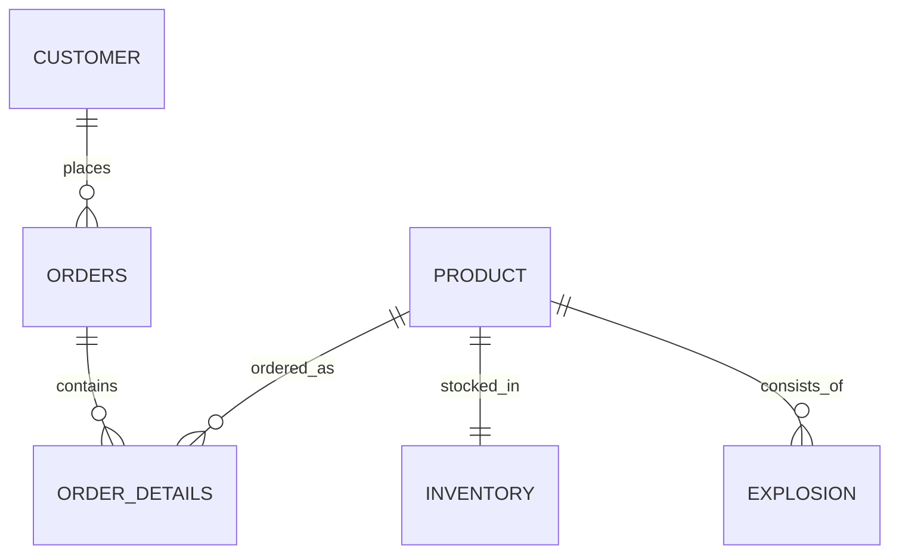

# Database relationships

## Tables

| Table | Purpose |
| --- | --- |
| `customer` | Customer contact and delivery addresses |
| `product` | Product catalogue and listed prices |
| `inventory` | Current stock and backorder quantities |
| `orders` | Customer orders and dates |
| `order_details` | Ordered products, quantities, fulfillment flags, and recorded line-unit prices |
| `explosion` | Parts required to assemble products |

The SQL uses foreign keys, check constraints, composite primary keys, and cascading deletes. The diagram is a conceptual view; inspect `sql/schema.sql` for exact constraints.

**Design limitations:** This is an educational model. Inventory contains a single row per product, order statuses are stored as two boolean flags, and no payments, warehouses, or stock-movement ledger are modeled. Cascading deletes are instructional rather than an appropriate audit-preserving default for every production system.
